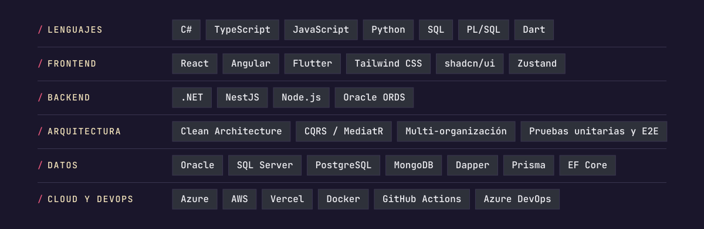

<a href="https://portafolio-eric-jimenez.vercel.app">
  <picture>
    <source media="(prefers-color-scheme: light)" srcset="assets/banner-light.svg">
    
  </picture>
</a>

  <a href="https://portafolio-eric-jimenez.vercel.app"><b>Portafolio</b></a> ·
  <a href="https://linkedin.com/in/eric-alberto-jimenez-collins"><b>LinkedIn</b></a> ·
  <a href="mailto:collinsjcwhite@gmail.com"><b>collinsjcwhite@gmail.com</b></a>

### Sobre mí

Desarrollador Full Stack en Santo Domingo, República Dominicana. Construyo aplicaciones web de punta a punta: interfaces en **React** y **Angular**, APIs en **.NET** con Clean Architecture y CQRS, y lógica de negocio sobre **Oracle (PL/SQL)** y **SQL Server**.

- 💼 **Analista Programador en Grupo Humano.** Desarrollo un portal interno que da a los agentes de Humano Seguros una vista 360° del cliente: pólizas, siniestros, cobranza, facturación e historial de pagos.
- 🛠️ **Construyendo SmartDinner,** una plataforma SaaS de punto de venta con facturación electrónica (e-CF) para negocios dominicanos.
- 🎓 **Tecnólogo en Desarrollo de Software** egresado del ITLA.

🇺🇸 Full Stack developer from the Dominican Republic working with .NET, React, Angular and Oracle. Currently a Programmer Analyst at Grupo Humano.

### Stack

<picture>
  <source media="(prefers-color-scheme: light)" srcset="assets/stack-light.svg">
  
</picture>

### Proyectos destacados

| Proyecto | Qué es | Stack |
|---|---|---|
| **SmartDinner**  🔒 privado · en desarrollo | Punto de venta SaaS multi-organización: caja, inventario, facturación electrónica (e-CF) y reportes para la DGII. Monorepo con contratos Zod compartidos y 558 pruebas automatizadas. | TypeScript · NestJS · Angular · PostgreSQL · Prisma · Nx |
| **Finanzas Personales**  🔒 privado | Control de ingresos, gastos, presupuestos y metas de ahorro, con escaneo de recibos y diagnóstico financiero usando Gemini. Instalable como PWA. | React · TypeScript · Tailwind · Turso · Gemini API |
| [**Northwind por contextos**](https://github.com/WhiteCollins/Northwind-1-) | API dividida por contexto (productos, suplidores, transportistas), cada uno con capas de dominio, aplicación, persistencia y API. | C# · .NET 8 · EF Core · SQL Server |
| [**Carga de almacén de datos**](https://github.com/WhiteCollins/dimensiones-del-almacen-de-datos) | Worker Service que extrae datos de Northwind y carga las dimensiones de un almacén de datos de órdenes. | C# · .NET 8 · Worker Service · SQL Server |
| [**Clasificador de flores**](https://github.com/WhiteCollins/project) | Clasifica fotos por lote con un modelo propio de Azure Custom Vision y descarga los resultados ordenados en un ZIP. | React · TypeScript · Vite · Azure Custom Vision |
| [**Mi Floristería**](https://github.com/WhiteCollins/flower-shop1) | Inventario de una floristería con catálogo por categorías, control de stock y estadísticas. | Next.js · TypeScript · shadcn/ui · Recharts |

Más en mi <a href="https://portafolio-eric-jimenez.vercel.app/#proyectos">portafolio</a>, disponible en español e inglés.

